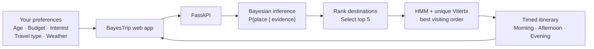
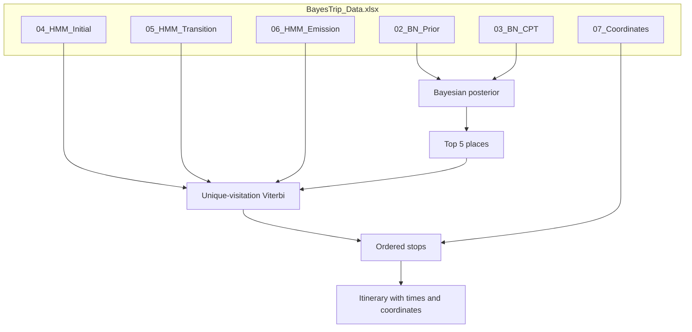

# BayesTrip

> **A smarter way to explore Chennai.** Tell BayesTrip what your trip looks like, and it will rank destinations and build a time-aware route for your day.

BayesTrip is an interactive trip recommender backed by a **Bayesian Network** and a **Hidden Markov Model (HMM)**. Its React experience lets you choose your travel preferences, then sends them to a Python API that scores destinations, finds a five-stop visiting order, and returns an itinerary for the map.

<p align="center">
  <strong>Choose your preferences</strong> &nbsp;→&nbsp;
  <strong>Discover your top destinations</strong> &nbsp;→&nbsp;
  <strong>Explore your itinerary</strong>
</p>

<p align="center">
  <a href="#-get-started">Get started</a> ·
  <a href="#-how-it-works">How it works</a> ·
  <a href="#-api">API</a> ·
  <a href="#-data-pipeline">Data pipeline</a> ·
  <a href="#-testing">Testing</a>
</p>

<details>
<summary><strong>Contents</strong></summary>

- [Highlights](#-highlights)
- [How it works](#-how-it-works)
- [Get started](#-get-started)
- [API](#-api)
- [Data pipeline](#-data-pipeline)
- [Project structure](#-project-structure)
- [Testing](#-testing)
- [Design notes](#-design-notes)

</details>

## ✨ Highlights

- **Personalized recommendations:** evidence about age, budget, interests, travel type, and weather informs each destination's Bayesian posterior.
- **An explainable shortlist:** the API returns the ranked top five, so the recommendation is transparent rather than a black box.
- **A route-aware day plan:** a unique-visitation Viterbi decoder sequences the five destinations using travel-time transitions and time-of-day opening-hour likelihoods.
- **Interactive web experience:** a React and Three.js interface presents the recommender and itinerary with animated, map-oriented results.
- **Reproducible data:** workbook tables are generated by separate Python modules, with formulas and sources documented in [`DESIGN.md`](DESIGN.md).

## 🧠 How it works



### Recommendation model

For each place, the engine combines its prior with the likelihood of the selected evidence:

```text
P(place | evidence) ∝ P(place) × Π P(evidence_k | place)
```

The resulting scores are normalized across destinations, sorted, and the top five are passed to the itinerary decoder. The decoder uses initial accessibility, pairwise travel transitions, and opening-hour emissions to select a sequence in which each shortlisted place is visited once.



## 🚀 Get started

### Prerequisites

- Python 3.10 or newer
- Node.js and npm
- A generated workbook at `data/BayesTrip_Data.xlsx` for recommendations

> [!IMPORTANT]
> The app reads its model data from `data/BayesTrip_Data.xlsx`. If that workbook is not already present in your local checkout, generate it before requesting recommendations; see the [data pipeline](#-data-pipeline). Coordinate generation requires a Geoapify API key, and the routing steps use the public OSRM service.

### 1. Install backend dependencies

From the repository root:

```bash
python -m venv .venv
```

Activate the environment, then install the project and API dependencies:

```bash
# Windows PowerShell
.venv\Scripts\Activate.ps1

# macOS / Linux
# source .venv/bin/activate

python -m pip install -r requirements-dev.txt
python -m pip install -r backend/requirements.txt
```

### 2. Install frontend dependencies

```bash
cd frontend
npm install
cd ..
```

### 3. Start the app

Run the API and web app in **separate terminals**, from the repository root:

```bash
python -m uvicorn backend.main:app --reload --port 8000
```

```bash
cd frontend
npm run dev
```

Open **http://localhost:5173**. The Vite development server proxies `/api` requests to the backend on port `8000`. The FastAPI interactive API documentation is available at **http://localhost:8000/docs**.

<details>
<summary><strong>Run the recommender from the command line</strong></summary>

With the Python environment active:

```bash
python -m recommendation_engine.pipeline
```

This runs the included example preferences and prints both the Bayesian top five and the decoded itinerary.

</details>

## 🔌 API

| Method | Endpoint | Description |
| --- | --- | --- |
| `GET` | `/api/options` | Evidence choices for the recommender form |
| `GET` | `/api/places` | Destination list, with coordinates when available |
| `POST` | `/api/recommend` | Compute the ranked destinations and itinerary |

### Example request

```bash
curl -X POST http://localhost:8000/api/recommend \
  -H "Content-Type: application/json" \
  -d "{\"age\":\"Student\",\"budget\":\"Low\",\"interest\":\"History\",\"travel_type\":\"Friends\",\"weather\":\"Sunny\"}"
```

The request body requires all five evidence fields:

```json
{
  "age": "Student",
  "budget": "Low",
  "interest": "History",
  "travel_type": "Friends",
  "weather": "Sunny"
}
```

The response contains `top5` (places ranked by posterior probability) and `itinerary` (the ordered stops, each with its slot, time range, place ID, name, latitude, and longitude). Invalid evidence returns HTTP `422`.

## 🏗️ Data pipeline

The recommendation engine reads its model tables from `data/BayesTrip_Data.xlsx`. Each data-generation module writes or replaces its own worksheet.

| Step | Workbook sheet | Purpose |
| ---: | --- | --- |
| 01 | `01_Place_Master` | Master list of 20 Chennai destinations |
| 02 | `07_Coordinates` | Destination coordinates, geocoded with Geoapify |
| 03 | `02_BN_Prior` | Popularity-based prior probabilities |
| 04 | `03_BN_CPT` | Conditional probability tables for user evidence |
| 05 | `04_HMM_Initial` | First-stop accessibility from Chennai Central |
| 06 | `05_HMM_Transition` | Pairwise travel-time transition probabilities |
| 07 | `06_HMM_Emission` | Opening-hour likelihoods for each time slot |
| 08 | `08_Evidence` | Provenance log for researched facts |
| 09 | `09_Validation` | Programmatic normalization and data checks |

<details>
<summary><strong>Regenerate the workbook</strong></summary>

Run the modules from the repository root, in order:

```bash
python -m data_generation.step01_place_master
python -m data_generation.step02_coordinates
python -m data_generation.step03_bn_prior
python -m data_generation.step04_bn_cpt
python -m data_generation.step05_hmm_initial
python -m data_generation.step06_hmm_transition
python -m data_generation.step07_hmm_emission
python -m data_generation.step08_evidence
python -m data_generation.step09_validation
```

Some generation steps use external services. In particular, coordinate generation requires a Geoapify key in the environment variable `GE0APIFY_API_KEY` (the variable name contains a zero). OSRM is used for routing data. The workbook is already provided for running the app, so you do not need to regenerate it for normal development.

</details>

## 📁 Project structure

```text
BayesTrip/
├── backend/                 FastAPI application and API dependencies
├── data/                    Generated workbook and evaluation artifacts
├── data_generation/         Workbook construction and validation modules
├── frontend/                React + Vite interactive web application
├── recommendation_engine/   Bayesian scoring, HMM decoding, itinerary builder
├── tests/                   Python unit tests
├── DESIGN.md                Data sources, formulas, and modeling decisions
├── evaluate_metrics.py      Evaluation entry point
├── requirements.txt         Core Python dependencies
└── requirements-dev.txt     Development and test dependencies
```

## 🧪 Testing

Install development dependencies (see [Get started](#-get-started)), then run:

```bash
python -m pytest tests/
```

The suite covers Bayesian scoring, HMM/Viterbi behavior, shared OSRM helpers, and workbook-generation steps.

To build the frontend for production:

```bash
cd frontend
npm run build
```

## 📐 Design notes

For the full explanation of sources, probability formulas, normalization, and missing-data handling, see [`DESIGN.md`](DESIGN.md).

<details>
<summary><strong>Model at a glance</strong></summary>

- **Bayesian prior:** popularity evidence is normalized to produce a prior over places.
- **Evidence likelihoods:** each selected evidence state contributes a conditional likelihood from the CPT.
- **Initial and transition probabilities:** OSRM travel times are transformed into accessibility scores; self-transitions are excluded.
- **Emissions:** opening-hour coverage provides likelihoods for Morning, Afternoon, and Evening, with a small nonzero floor.
- **Itinerary:** Viterbi finds the best ordering while visiting each of the five shortlisted places exactly once. The five positions are mapped across existing time-of-day slots, with repeated slots split into separate time ranges.

</details>

---

<p align="center"><em>Plan a day in Chennai with a little more intelligence.</em></p>
